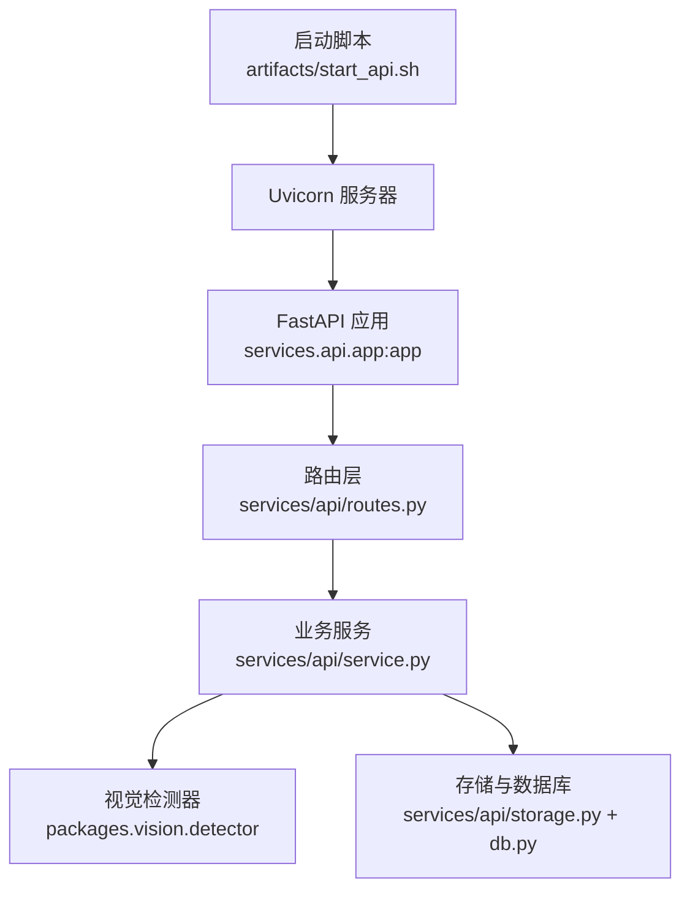
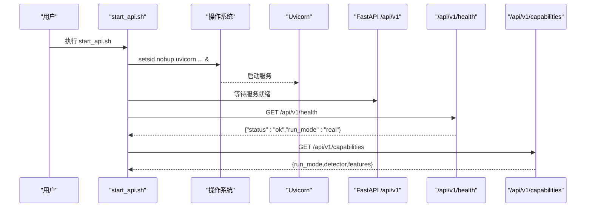
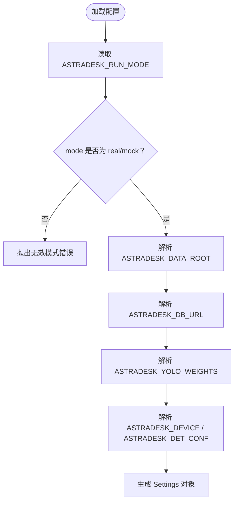
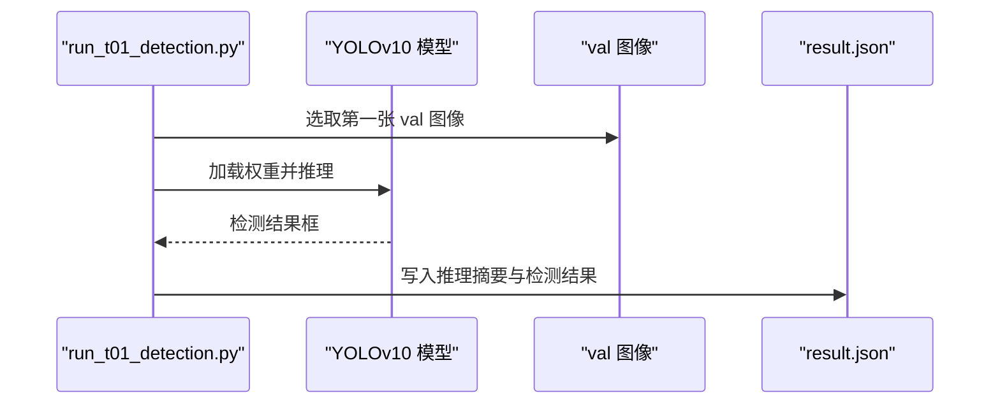
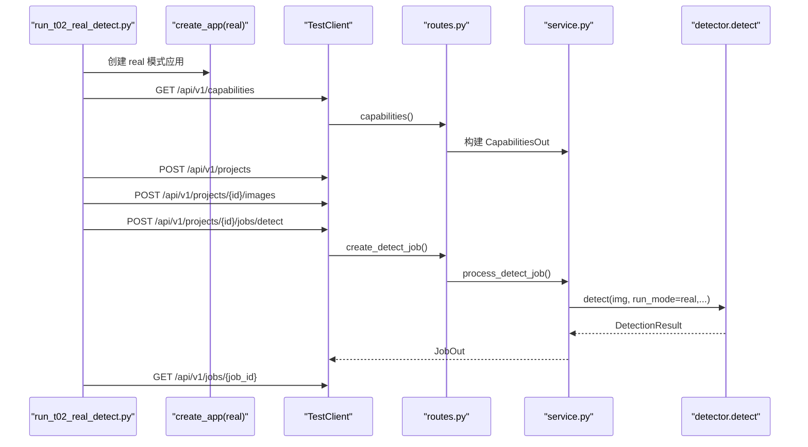
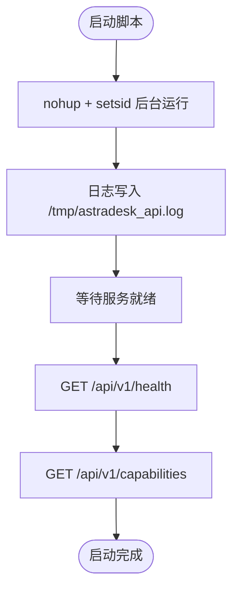
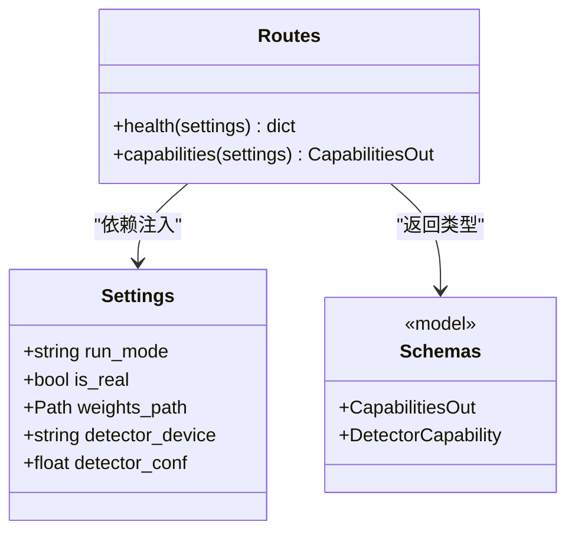

# 服务启动

<cite>
**本文引用的文件**   
- [start_api.sh](file://artifacts/start_api.sh)
- [run_t01.sh](file://artifacts/run_t01.sh)
- [run_t02.sh](file://artifacts/run_t02.sh)
- [run_t02_api.sh](file://artifacts/run_t02_api.sh)
- [run_t01_detection.py](file://artifacts/run_t01_detection.py)
- [run_t02_real_detect.py](file://artifacts/run_t02_real_detect.py)
- [app.py](file://services/api/app.py)
- [routes.py](file://services/api/routes.py)
- [config.py](file://services/api/config.py)
- [service.py](file://services/api/service.py)
- [schemas.py](file://services/api/schemas.py)
</cite>

## 目录
1. [简介](#简介)
2. [项目结构与启动入口](#项目结构与启动入口)
3. [后端 API 启动方式](#后端-api-启动方式)
4. [运行模式与参数配置](#运行模式与参数配置)
5. [检测任务执行流程](#检测任务执行流程)
6. [进程管理与日志](#进程管理与日志)
7. [健康检查与能力查询](#健康检查与能力查询)
8. [服务启动最佳实践](#服务启动最佳实践)
9. [常见启动失败原因与排查](#常见启动失败原因与排查)
10. [结论](#结论)

## 简介
本文面向 AstraDesk 的后端 API 服务，说明如何正确启动服务、切换 real 与 mock 运行模式、执行 T01/T02 检测验证脚本、管理后台进程、查看日志，并通过 `/api/v1/health` 与 `/api/v1/capabilities` 完成健康检查与能力探测。文档同时给出端口、网络绑定、资源限制等生产相关建议，以及启动失败的常见原因和排查方法。

## 项目结构与启动入口
AstraDesk 的后端 API 基于 FastAPI，由 `services.api.app` 暴露应用实例，通过 Uvicorn 启动。脚本层提供三类入口：
- `artifacts/start_api.sh`：以 real 模式启动真实 YOLOv10 权重，后台运行并自检健康与能力。
- `artifacts/run_t01.sh`：执行 T01 图像检测验证，使用本地 YOLOv10n 权重对一张真实 val 图推理。
- `artifacts/run_t02.sh`：执行 T02 端到端真实检测验证，通过完整 API 栈调用真实模型。
- `artifacts/run_t02_api.sh`：以 mock 模式临时启动 API，探活后自动停止，用于契约测试。

**图表来源**
- [start_api.sh:1-20](file://artifacts/start_api.sh#L1-L20)
- [app.py:24-47](file://services/api/app.py#L24-L47)
- [routes.py:28-65](file://services/api/routes.py#L28-L65)
- [service.py:132-179](file://services/api/service.py#L132-L179)

**章节来源**
- [start_api.sh:1-20](file://artifacts/start_api.sh#L1-L20)
- [run_t01.sh:1-7](file://artifacts/run_t01.sh#L1-L7)
- [run_t02.sh:1-8](file://artifacts/run_t02.sh#L1-L8)
- [run_t02_api.sh:1-25](file://artifacts/run_t02_api.sh#L1-L25)
- [app.py:24-47](file://services/api/app.py#L24-L47)

## 后端 API 启动方式
推荐通过 `artifacts/start_api.sh` 启动后端 API。该脚本会：
- 切换到项目根目录。
- 设置运行模式为 real。
- 指定 YOLOv10 权重路径与数据根目录。
- 清理旧日志。
- 使用 `setsid nohup` 后台启动 Uvicorn，监听 `127.0.0.1:8000`。
- 等待服务就绪后输出最近日志，并调用健康检查与能力查询接口。

**图表来源**
- [start_api.sh:1-20](file://artifacts/start_api.sh#L1-L20)
- [routes.py:46-65](file://services/api/routes.py#L46-L65)

**章节来源**
- [start_api.sh:1-20](file://artifacts/start_api.sh#L1-L20)
- [routes.py:46-65](file://services/api/routes.py#L46-L65)

## 运行模式与参数配置
AstraDesk 支持两种运行模式：
- real：真实模型推理，依赖 YOLOv10 权重与 GPU/CPU 环境；若模型不可用，直接返回 `MODEL_UNAVAILABLE`，不静默回退到 mock。
- mock：确定性 Mock，仅用于无 GPU 的契约测试与演示；能力接口如实标注为 mock。

关键环境变量如下：
- `ASTRADESK_RUN_MODE`：运行模式，取值 `real` 或 `mock`；默认 `mock`。
- `ASTRADESK_DATA_ROOT`：数据根目录，默认在项目根目录的 `data`。
- `ASTRADESK_DB_URL`：数据库连接字符串，默认 SQLite 位于 `data/astradesk.db`。
- `ASTRADESK_YOLO_WEIGHTS`：YOLOv10 权重路径，默认 `weights/yolov10n.pt`。
- `ASTRADESK_DEVICE`：检测设备，空值表示由底层自动选择 CUDA/CPU。
- `ASTRADESK_DET_CONF`：检测置信度阈值，默认 `0.25`。

**图表来源**
- [config.py:17-60](file://services/api/config.py#L17-L60)

**章节来源**
- [config.py:1-60](file://services/api/config.py#L1-L60)

## 检测任务执行流程
T01 与 T02 是两个不同层次的验证脚本：
- T01：独立于 API 的图像检测验证，直接使用 YOLOv10 权重在真实图上推理，保存结果 JSON 与标注图。
- T02：端到端真实检测验证，通过 FastAPI TestClient 走完整 API 路由，创建项目、上传图片、提交检测任务、查询结果，并绘制检测结果。

**图表来源**
- [run_t01_detection.py:18-78](file://artifacts/run_t01_detection.py#L18-L78)

**图表来源**
- [run_t02_real_detect.py:42-107](file://artifacts/run_t02_real_detect.py#L42-L107)
- [routes.py:130-142](file://services/api/routes.py#L130-L142)
- [service.py:132-179](file://services/api/service.py#L132-L179)

**章节来源**
- [run_t01_detection.py:1-79](file://artifacts/run_t01_detection.py#L1-L79)
- [run_t02_real_detect.py:1-108](file://artifacts/run_t02_real_detect.py#L1-L108)
- [routes.py:130-142](file://services/api/routes.py#L130-L142)
- [service.py:132-179](file://services/api/service.py#L132-L179)

## 进程管理与日志
- 后台运行：`start_api.sh` 使用 `setsid nohup` 将 Uvicorn 放入后台会话，避免终端关闭导致服务退出。
- 进程监控：脚本输出 `STARTED_PID=$!`，可通过该 PID 查看进程状态（例如使用系统进程工具）。
- 日志位置：Uvicorn 标准输出与错误重定向到 `/tmp/astradesk_api.log`。脚本启动后会打印最近 15 行日志。
- 健康检查：脚本启动后等待数秒，再调用 `/api/v1/health` 与 `/api/v1/capabilities`，确认服务就绪。

**图表来源**
- [start_api.sh:7-19](file://artifacts/start_api.sh#L7-L19)

**章节来源**
- [start_api.sh:7-19](file://artifacts/start_api.sh#L7-L19)

## 健康检查与能力查询
- 健康检查端点：`GET /api/v1/health`，返回服务状态与当前运行模式。
- 能力查询端点：`GET /api/v1/capabilities`，返回运行模式、检测器可用性、模型名称与版本、可用功能列表。

**图表来源**
- [routes.py:46-65](file://services/api/routes.py#L46-L65)
- [config.py:20-31](file://services/api/config.py#L20-L31)
- [schemas.py:74-83](file://services/api/schemas.py#L74-L83)

**章节来源**
- [routes.py:46-65](file://services/api/routes.py#L46-L65)
- [schemas.py:74-83](file://services/api/schemas.py#L74-L83)

## 服务启动最佳实践
- 端口配置：默认监听 `8000`，可在启动命令中修改 `--port`。测试脚本 `run_t02_api.sh` 使用 `8123` 作为临时端口。
- 网络绑定：默认绑定 `127.0.0.1`，仅本机访问；如需外部访问，应结合反向代理与安全策略调整 `--host`。
- 运行模式：生产建议使用 `real`，并确保权重文件存在且可加载；开发或无 GPU 环境可使用 `mock`。
- 数据与数据库：明确设置 `ASTRADESK_DATA_ROOT` 与 `ASTRADESK_DB_URL`，避免默认路径权限不足。
- 资源限制：合理设置 `ASTRADESK_DET_CONF` 控制检测灵敏度；在容器或受限环境中限制 CPU/GPU 内存。
- 日志与监控：保留 `/tmp/astradesk_api.log`，并结合进程管理器（如 systemd）进行重启与健康检查。

[本节为通用指导，不直接分析具体文件]

## 常见启动失败原因与排查
- 权重文件缺失或路径错误：
  - 现象：real 模式下能力查询显示检测器不可用，或检测任务失败并返回 `MODEL_UNAVAILABLE`。
  - 排查：检查 `ASTRADESK_YOLO_WEIGHTS` 是否指向有效权重文件；确认文件可读。
  - 依据：能力查询在 real 模式下尝试加载模型，失败时返回不可用信息；检测任务捕获 `DetectorUnavailable` 并标记失败。

- 运行模式配置错误：
  - 现象：启动时报无效模式错误。
  - 排查：确认 `ASTRADESK_RUN_MODE` 为 `real` 或 `mock`；注意 `demo` 会被等价转换为 `mock`。
  - 依据：配置加载时对模式进行校验，非法值抛出异常。

- 端口占用或网络绑定问题：
  - 现象：Uvicorn 无法启动或健康检查失败。
  - 排查：检查 `--host` 与 `--port`；确认端口未被占用；本机访问时使用 `127.0.0.1`。
  - 依据：启动脚本固定绑定 `127.0.0.1:8000`；测试脚本使用 `127.0.0.1:8123`。

- 数据目录权限不足：
  - 现象：上传图像或写库失败。
  - 排查：确保 `ASTRADESK_DATA_ROOT` 可写；SQLite 数据库文件可创建。
  - 依据：应用启动时会创建数据根目录；上传与存储逻辑依赖该路径。

- 日志为空或服务未就绪：
  - 现象：健康检查失败或能力查询超时。
  - 排查：查看 `/tmp/astradesk_api.log`；确认服务已启动；适当延长等待时间。
  - 依据：启动脚本在后台启动后等待数秒并输出日志尾部。

**章节来源**
- [config.py:39-60](file://services/api/config.py#L39-L60)
- [routes.py:51-65](file://services/api/routes.py#L51-L65)
- [service.py:132-179](file://services/api/service.py#L132-L179)
- [start_api.sh:7-19](file://artifacts/start_api.sh#L7-L19)

## 结论
AstraDesk 的服务启动以 `artifacts/start_api.sh` 为核心入口，支持 real 与 mock 两种运行模式，并通过 `/api/v1/health` 与 `/api/v1/capabilities` 提供健康检查与能力探测。T01 与 T02 分别覆盖独立推理与端到端 API 验证。生产部署时应关注端口、网络绑定、数据路径与资源限制，并结合日志与进程管理实现稳定运行。遇到启动失败时，优先检查权重路径、运行模式、端口占用与数据目录权限。

[本节为总结性内容，不直接分析具体文件]