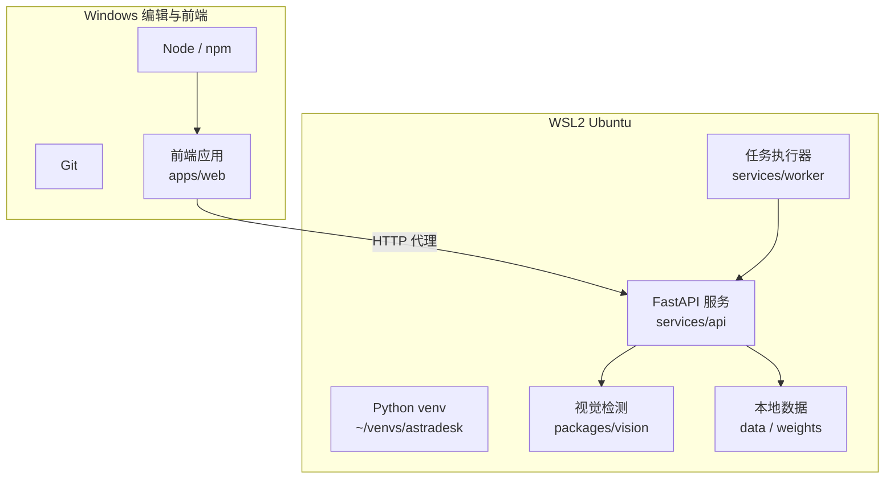
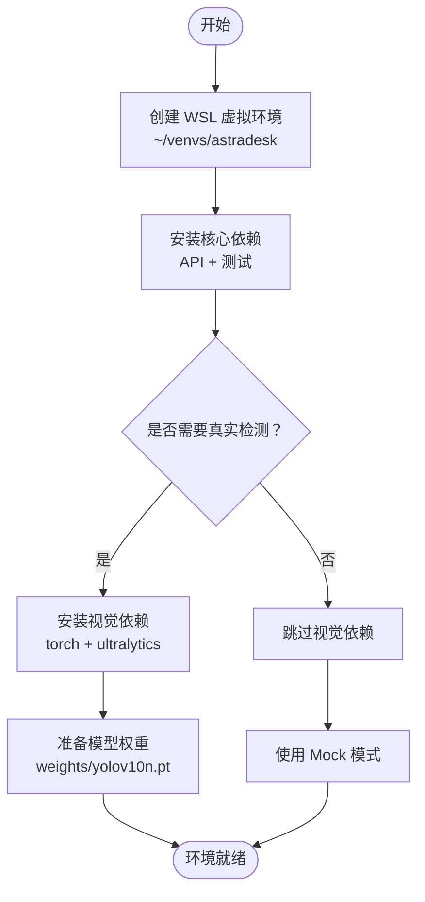
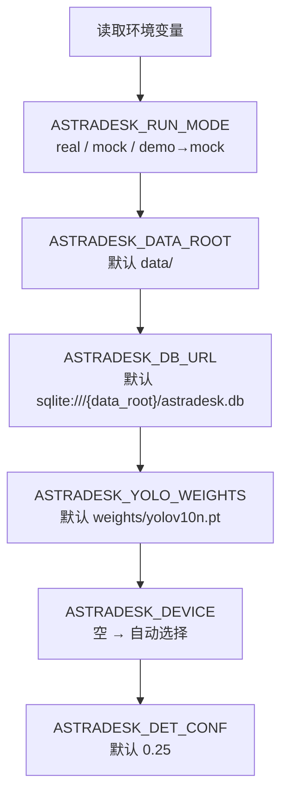
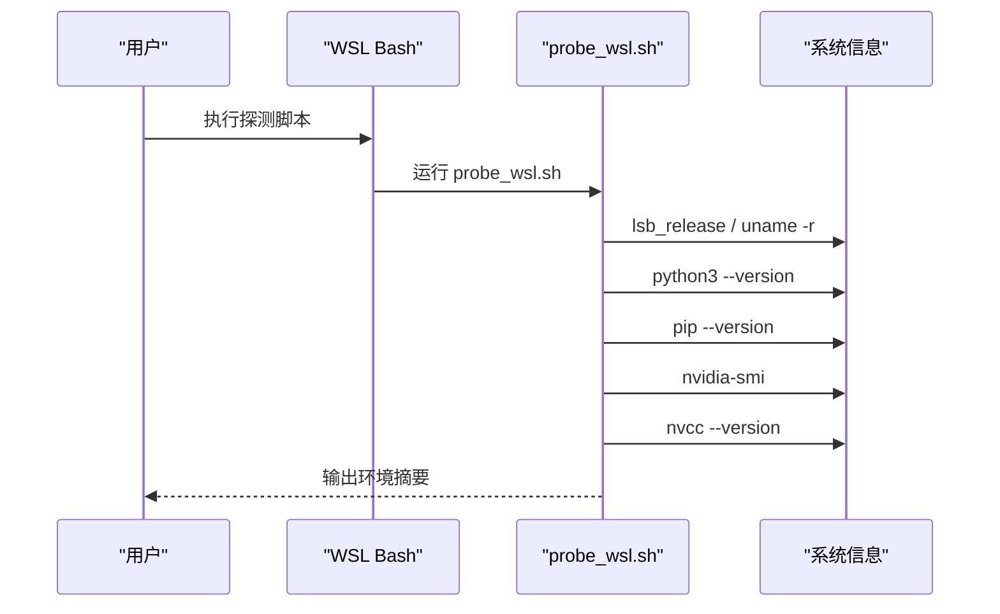
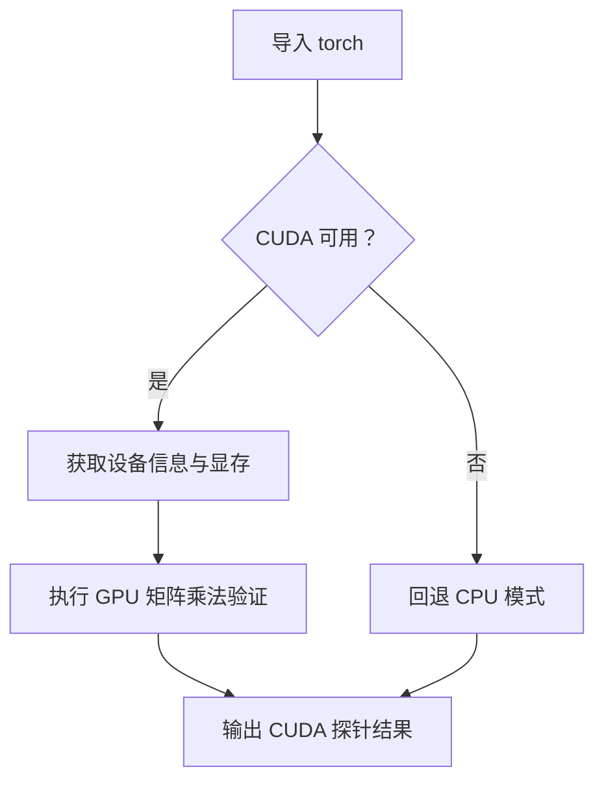
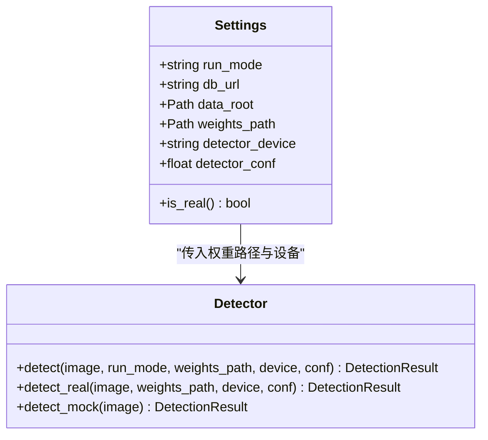
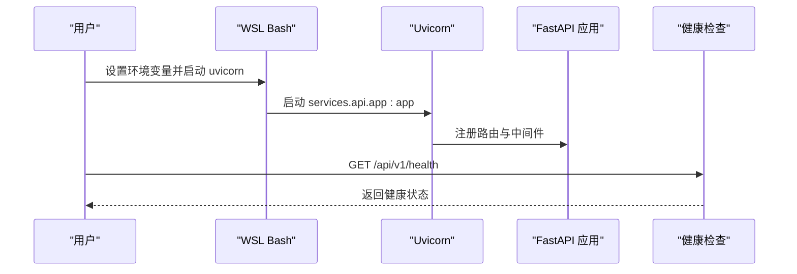

# 环境配置

<cite>
**本文引用的文件**   
- [README.md](file://README.md)
- [ENVIRONMENT.md](file://docs/ENVIRONMENT.md)
- [pyproject.toml](file://pyproject.toml)
- [config.py](file://services/api/config.py)
- [detector.py](file://packages/vision/detector.py)
- [probe_wsl.sh](file://artifacts/probe_wsl.sh)
- [probe_torch_cuda.py](file://artifacts/probe_torch_cuda.py)
- [run_t02_api.sh](file://artifacts/run_t02_api.sh)
</cite>

## 目录
1. [引言](#引言)
2. [项目结构与环境定位](#项目结构与环境定位)
3. [系统要求](#系统要求)
4. [依赖安装流程](#依赖安装流程)
5. [环境变量与运行模式](#环境变量与运行模式)
6. [WSL2 特殊配置](#wsl2-特殊配置)
7. [GPU 与 CUDA 配置](#gpu-与-cuda-配置)
8. [启动与服务验证](#启动与服务验证)
9. [常见问题诊断](#常见问题诊断)
10. [性能与稳定性建议](#性能与稳定性建议)
11. [结论](#结论)

## 引言
本指南面向首次部署 AstraDesk 的用户，重点说明如何在 Windows、Linux 和 WSL2 环境下完成系统准备、依赖安装、环境变量配置、GPU/CUDA 启用以及问题排查。文档同时覆盖真实检测模式与 Mock 模式的差异，并给出可操作的命令路径与验证步骤。

## 项目结构与环境定位
AstraDesk 采用前后端分离结构：
- 前端位于 `apps/web`，使用 React + TypeScript + Vite，在 Windows 侧通过 Node 开发。
- 后端 API 位于 `services/api`，基于 FastAPI + Uvicorn。
- 视觉检测逻辑位于 `packages/vision`，支持 YOLOv10 真实推理与确定性 Mock。
- 任务执行入口位于 `services/worker`。
- 契约与样例位于 `contracts`，测试位于 `tests`。
- 运行时数据与权重默认放在 `data` 与 `weights`（已加入 `.gitignore`）。

**图表来源**
- [README.md:8-24](file://README.md#L8-L24)
- [pyproject.toml:23-32](file://pyproject.toml#L23-L32)

**章节来源**
- [README.md:8-24](file://README.md#L8-L24)
- [pyproject.toml:23-32](file://pyproject.toml#L23-L32)

## 系统要求
### Python 版本
- 项目声明最低 Python 版本为 3.10+。
- 实测记录中服务侧 Python 为 3.12.3，处于期望区间。
- 编辑侧 Python 仅用于编辑器参考，不用于服务运行。

### 操作系统兼容性
- 宿主系统：Windows（推荐用于编辑与前端开发）。
- 服务运行：WSL2 Ubuntu（推荐 Ubuntu 24.04 LTS）。
- 前端构建：Windows 侧 Node v24。

### GPU 与驱动
- 已验证 NVIDIA RTX 4050 Laptop，显存约 6GB。
- 驱动层在 Windows 与 WSL2 直通下均可识别。
- CUDA 运行时由 PyTorch cu124 轮子提供；nvcc 仅在需要本地编译自定义算子时才需安装。

**章节来源**
- [pyproject.toml:9](file://pyproject.toml#L9)
- [ENVIRONMENT.md:5-24](file://docs/ENVIRONMENT.md#L5-L24)
- [README.md:26-31](file://README.md#L26-L31)

## 依赖安装流程
### 创建虚拟环境
建议在 WSL2 原生文件系统下创建虚拟环境，避免 `/mnt/d` 的慢 I/O：
- 路径示例：`~/venvs/astradesk`
- 激活后使用对应 pip 安装依赖。

### 安装核心依赖
- API 与基础依赖：安装开发包以包含测试工具。
- 视觉依赖：如需真实检测，额外安装视觉可选依赖。

**图表来源**
- [README.md:33-47](file://README.md#L33-L47)
- [pyproject.toml:19-21](file://pyproject.toml#L19-L21)

**章节来源**
- [README.md:33-47](file://README.md#L33-L47)
- [pyproject.toml:19-21](file://pyproject.toml#L19-L21)

## 环境变量与运行模式
### 运行模式
- `real`：真实模型推理。若缺少权重或依赖，直接返回不可用错误，不会静默降级到 Mock。
- `mock`：确定性 Mock，适用于无 GPU 环境与契约测试。能力接口会如实标注 Mock 检测器。

### 关键环境变量
- `ASTRADESK_RUN_MODE`：控制运行模式，取值 `real` 或 `mock`；`demo` 会被归一化为 `mock`。
- `ASTRADESK_YOLO_WEIGHTS`：YOLO 权重路径；未设置时默认指向项目根下的 `weights/yolov10n.pt`。
- `ASTRADESK_DATA_ROOT`：数据存储根路径；未设置时默认指向项目根下的 `data`。
- `ASTRADESK_DB_URL`：数据库连接字符串；未设置时默认基于 `ASTRADESK_DATA_ROOT` 生成 SQLite 路径。
- `ASTRADESK_DEVICE`：检测设备标识；空值表示自动选择 cuda/cpu。
- `ASTRADESK_DET_CONF`：检测置信度阈值；默认值为 0.25。

**图表来源**
- [config.py:39-60](file://services/api/config.py#L39-L60)

**章节来源**
- [README.md:71-77](file://README.md#L71-L77)
- [config.py:1-60](file://services/api/config.py#L1-L60)

## WSL2 特殊配置
### 基础探测脚本
可使用探测脚本检查 WSL 发行版、内核、Python、pip、venv、Node、GPU 驱动、CUDA 编译器与磁盘空间。

**图表来源**
- [probe_wsl.sh:1-19](file://artifacts/probe_wsl.sh#L1-L19)

**章节来源**
- [ENVIRONMENT.md:5-24](file://docs/ENVIRONMENT.md#L5-L24)
- [probe_wsl.sh:1-19](file://artifacts/probe_wsl.sh#L1-L19)

### 常见 WSL 注意事项
- 优先将虚拟环境放在 WSL 原生 ext4 文件系统，避免跨盘符访问导致的 I/O 性能问题。
- 如果 WSL 内缺失 pip 或 venv，可通过系统包管理器安装对应组件后再创建虚拟环境。
- 前端开发建议使用 Windows 侧 Node，避免在 WSL 内重复安装 Node。

**章节来源**
- [README.md:26-31](file://README.md#L26-L31)
- [ENVIRONMENT.md:26-35](file://docs/ENVIRONMENT.md#L26-L35)

## GPU 与 CUDA 配置
### PyTorch 与 CUDA 运行时
- 推荐使用带 CUDA 支持的 PyTorch 轮子（如 cu124），以便直接使用 GPU。
- 可通过探针脚本验证 CUDA 可用性、设备名称、计算能力、显存大小与矩阵乘法结果。

**图表来源**
- [probe_torch_cuda.py:1-24](file://artifacts/probe_torch_cuda.py#L1-L24)

**章节来源**
- [ENVIRONMENT.md:13-18](file://docs/ENVIRONMENT.md#L13-L18)
- [probe_torch_cuda.py:1-24](file://artifacts/probe_torch_cuda.py#L1-L24)

### 检测器设备与权重
- 检测器会根据 `ASTRADESK_DEVICE` 决定是否指定设备；为空时由底层框架自动选择。
- 权重文件必须存在；否则真实检测会抛出不可用异常，不会静默降级。

**图表来源**
- [config.py:20-60](file://services/api/config.py#L20-L60)
- [detector.py:50-129](file://packages/vision/detector.py#L50-L129)

**章节来源**
- [config.py:20-60](file://services/api/config.py#L20-L60)
- [detector.py:50-129](file://packages/vision/detector.py#L50-L129)

## 启动与服务验证
### 启动 API 服务
- 默认使用 Mock 模式；如需真实检测，设置 `ASTRADESK_RUN_MODE=real` 并提供权重路径。
- 健康检查端点可用于验证服务是否成功启动。

**图表来源**
- [README.md:40-50](file://README.md#L40-L50)
- [run_t02_api.sh:1-25](file://artifacts/run_t02_api.sh#L1-L25)

**章节来源**
- [README.md:40-50](file://README.md#L40-L50)
- [run_t02_api.sh:1-25](file://artifacts/run_t02_api.sh#L1-L25)

### 独立任务执行器
- 可选择启动独立 worker，轮询执行队列中的检测任务。
- 该方式适合异步处理与批量任务场景。

**章节来源**
- [README.md:45-47](file://README.md#L45-L47)

## 常见问题诊断
### CUDA 版本冲突
- 症状：PyTorch 无法识别 CUDA 或 GPU 计算失败。
- 诊断：使用 CUDA 探针脚本检查 `cuda_available`、`torch_cuda_version`、设备信息与矩阵乘法结果。
- 解决：确保安装的 PyTorch 轮子与目标 CUDA 运行时匹配；必要时更换 cu124 或其他兼容版本。

**章节来源**
- [probe_torch_cuda.py:1-24](file://artifacts/probe_torch_cuda.py#L1-L24)
- [ENVIRONMENT.md:13-18](file://docs/ENVIRONMENT.md#L13-L18)

### 依赖包安装失败
- 症状：安装 `torch` 或 `ultralytics` 时报错。
- 诊断：确认 Python 版本满足 3.10+；确认虚拟环境激活正确；检查网络与镜像源。
- 解决：重新创建虚拟环境并安装可选依赖；必要时切换镜像源或使用离线包。

**章节来源**
- [pyproject.toml:9](file://pyproject.toml#L9)
- [pyproject.toml:19-21](file://pyproject.toml#L19-L21)

### 权重文件缺失
- 症状：真实检测报模型不可用。
- 诊断：检查 `ASTRADESK_YOLO_WEIGHTS` 指向的路径是否存在。
- 解决：放置正确的权重文件，或更新环境变量指向有效路径。

**章节来源**
- [detector.py:50-65](file://packages/vision/detector.py#L50-L65)
- [config.py:47-50](file://services/api/config.py#L47-L50)

### 运行模式误配
- 症状：Mock 模式未生效或真实模式意外触发。
- 诊断：检查 `ASTRADESK_RUN_MODE` 是否为 `real` 或 `mock`；注意 `demo` 会被归一化为 `mock`。
- 解决：修正环境变量后重启服务。

**章节来源**
- [config.py:39-45](file://services/api/config.py#L39-L45)

### 数据路径与数据库 URL
- 症状：数据库文件找不到或写入失败。
- 诊断：检查 `ASTRADESK_DATA_ROOT` 与 `ASTRADESK_DB_URL`。
- 解决：确保数据目录存在且可写；SQLite 默认路径基于 `data_root`。

**章节来源**
- [config.py:47-49](file://services/api/config.py#L47-L49)

## 性能与稳定性建议
- 将虚拟环境放在 WSL 原生文件系统，避免跨盘符 I/O 瓶颈。
- 使用带 CUDA 的 PyTorch 轮子以减少编译开销。
- 合理设置检测置信度阈值，平衡召回率与误检率。
- 对长生命周期进程复用模型实例，避免每次请求重载模型。
- 在生产环境中限制日志与遥测输出，减少不必要的网络请求。

[本节为通用指导，不直接分析具体文件]

## 结论
通过遵循本指南，您可以在 Windows、Linux 与 WSL2 环境下稳定部署 AstraDesk。重点包括：
- 使用 WSL2 原生文件系统创建虚拟环境。
- 根据需求安装核心依赖与视觉依赖。
- 正确配置运行模式、权重路径、数据根路径与设备参数。
- 使用探测脚本验证 CUDA 与 GPU 可用性。
- 遇到问题时按诊断清单逐步排查。

[本节为总结性内容，不直接分析具体文件]