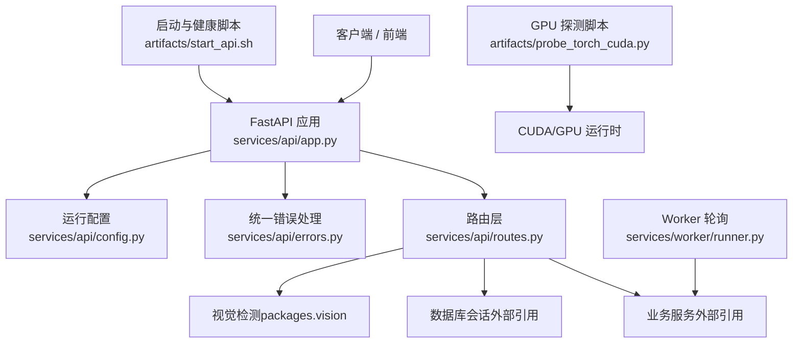
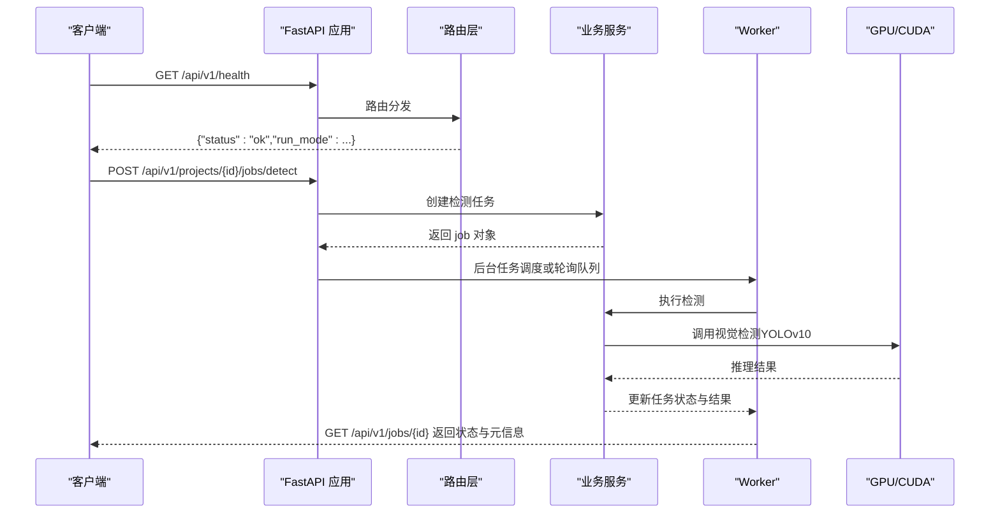
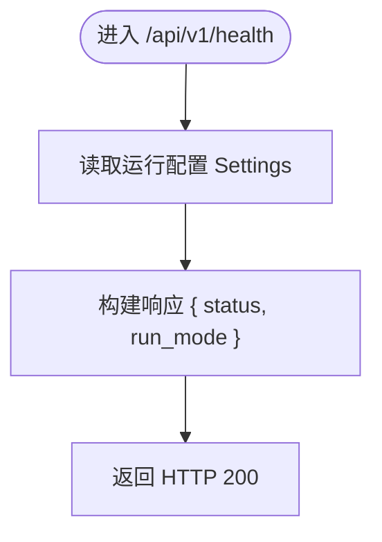
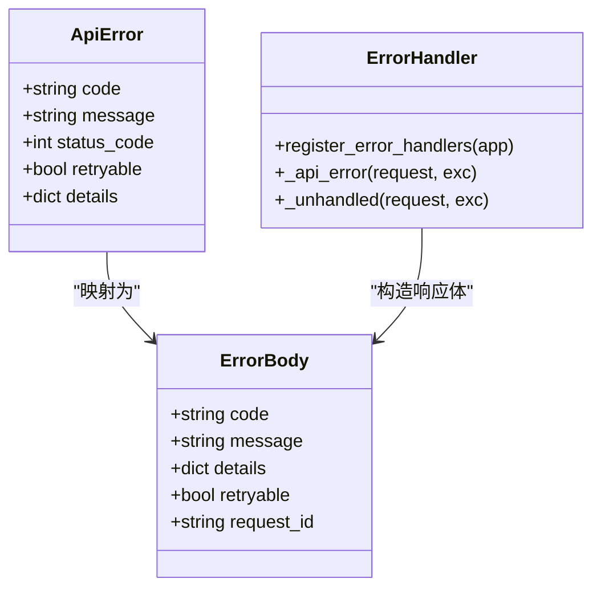
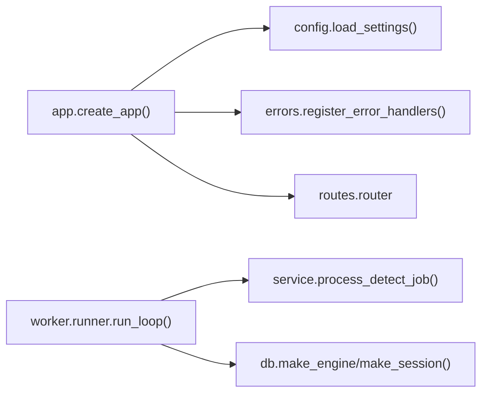
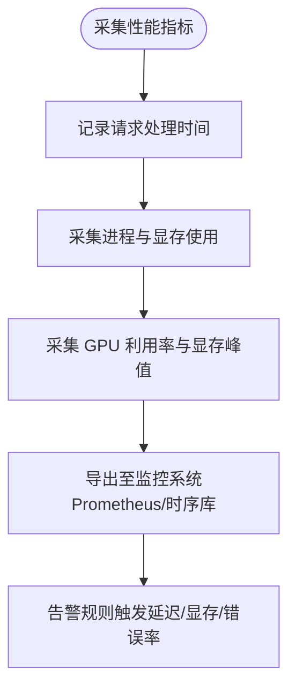

# 监控日志

<cite>
**本文引用的文件**   
- [services/api/app.py](file://services/api/app.py)
- [services/api/routes.py](file://services/api/routes.py)
- [services/api/config.py](file://services/api/config.py)
- [services/api/errors.py](file://services/api/errors.py)
- [services/api/schemas.py](file://services/api/schemas.py)
- [services/worker/runner.py](file://services/worker/runner.py)
- [artifacts/start_api.sh](file://artifacts/start_api.sh)
- [artifacts/probe_torch_cuda.py](file://artifacts/probe_torch_cuda.py)
- [artifacts/probe_torch_cuda_result.json](file://artifacts/probe_torch_cuda_result.json)
- [contracts/error.schema.json](file://contracts/error.schema.json)
- [contracts/detection_result.schema.json](file://contracts/detection_result.schema.json)
- [README.md](file://README.md)
- [docs/ENVIRONMENT.md](file://docs/ENVIRONMENT.md)
</cite>

## 目录
1. [引言](#引言)
2. [项目结构](#项目结构)
3. [核心组件](#核心组件)
4. [架构总览](#架构总览)
5. [详细组件分析](#详细组件分析)
6. [依赖关系分析](#依赖关系分析)
7. [性能与监控指标](#性能与监控指标)
8. [错误追踪与调试](#错误追踪与调试)
9. [监控工具集成方案](#监控工具集成方案)
10. [日志分析与常见问题定位](#日志分析与常见问题定位)
11. [结论](#结论)

## 引言
本指南面向 AstraDesk 的运维、开发与平台工程团队，聚焦“监控与日志”主题。当前代码库已提供基础健康检查、统一错误对象、检测任务状态与结果元信息、以及 GPU/CUDA 探测脚本；但尚未内置结构化日志框架、Prometheus 指标暴露或 Grafana 仪表板。本文在严格依据仓库现有实现的基础上，给出可落地的扩展建议与集成方案，帮助你在不破坏现有契约的前提下补齐生产级可观测性。

## 项目结构
AstraDesk 后端以 FastAPI 为主入口，路由集中在 `/api/v1`，业务逻辑通过 service 层解耦，worker 提供独立的任务执行入口。监控相关的关键位置包括：
- API 装配与健康端点：`services/api/app.py`、`services/api/routes.py`
- 运行配置与环境变量：`services/api/config.py`
- 统一错误处理与请求上下文：`services/api/errors.py`、`services/api/schemas.py`
- Worker 轮询执行器：`services/worker/runner.py`
- 启动与健康自检脚本：`artifacts/start_api.sh`
- GPU/CUDA 能力探测脚本与结果：`artifacts/probe_torch_cuda.py`、`artifacts/probe_torch_cuda_result.json`
- 错误契约与检测结果契约：`contracts/error.schema.json`、`contracts/detection_result.schema.json`

**图示来源**
- [services/api/app.py:24-47](file://services/api/app.py#L24-L47)
- [services/api/routes.py:28-48](file://services/api/routes.py#L28-L48)
- [services/api/errors.py:35-55](file://services/api/errors.py#L35-L55)
- [services/api/config.py:39-60](file://services/api/config.py#L39-L60)
- [services/worker/runner.py:16-42](file://services/worker/runner.py#L16-L42)
- [artifacts/start_api.sh:1-19](file://artifacts/start_api.sh#L1-L19)
- [artifacts/probe_torch_cuda.py:1-23](file://artifacts/probe_torch_cuda.py#L1-L23)

**章节来源**
- [services/api/app.py:24-47](file://services/api/app.py#L24-L47)
- [services/api/routes.py:28-48](file://services/api/routes.py#L28-L48)
- [services/api/config.py:39-60](file://services/api/config.py#L39-L60)
- [services/worker/runner.py:16-42](file://services/worker/runner.py#L16-L42)
- [artifacts/start_api.sh:1-19](file://artifacts/start_api.sh#L1-L19)

## 核心组件
- 健康检查端点：返回服务状态与运行模式，用于探针与负载均衡健康判断。
- 能力探测接口：在真实模式下尝试加载模型并报告可用性；mock 模式明确标注。
- 统一错误对象：所有异常响应遵循统一结构，包含错误码、消息、重试标志与请求 ID。
- 检测任务状态与结果：任务查询返回状态、阶段、耗时、设备、图像尺寸与检测数量等元信息。
- Worker 轮询执行器：独立进程拉取 queued 任务并执行检测。
- GPU/CUDA 探测脚本：验证 CUDA 可用性与显存占用，辅助性能基线评估。

**章节来源**
- [services/api/routes.py:46-65](file://services/api/routes.py#L46-L65)
- [services/api/errors.py:12-55](file://services/api/errors.py#L12-L55)
- [services/api/schemas.py:9-38](file://services/api/schemas.py#L9-L38)
- [services/worker/runner.py:16-42](file://services/worker/runner.py#L16-L42)
- [artifacts/probe_torch_cuda.py:1-23](file://artifacts/probe_torch_cuda.py#L1-L23)

## 架构总览
下图展示从客户端到后端、再到 worker 与 GPU 运行时的关键交互路径，以及健康检查与错误处理的接入点。

**图示来源**
- [services/api/routes.py:130-142](file://services/api/routes.py#L130-L142)
- [services/worker/runner.py:16-42](file://services/worker/runner.py#L16-L42)
- [artifacts/probe_torch_cuda.py:1-23](file://artifacts/probe_torch_cuda.py#L1-L23)

## 详细组件分析

### 健康检查机制
- 端点：`GET /api/v1/health`
- 响应字段：
  - `status`：固定为 `ok`，表示服务进程已启动且路由注册成功。
  - `run_mode`：来自运行配置，值为 `real` 或 `mock`。
- 服务状态判断逻辑：
  - 当前实现仅校验应用装配与路由注册，未主动检查数据库连接、磁盘空间或 GPU 可用性。
  - 若需增强，可在该端点中增加对数据库、权重文件、GPU 能力的探测，并在失败时返回非 `ok` 状态与诊断信息。
- 依赖服务检查：
  - 当前未实现依赖健康检查；建议在后续版本引入依赖健康检查中间件或扩展 `/health` 子端点（如 `/health/db`、`/health/gpu`）。

**图示来源**
- [services/api/routes.py:46-48](file://services/api/routes.py#L46-L48)
- [services/api/config.py:20-31](file://services/api/config.py#L20-L31)

**章节来源**
- [services/api/routes.py:46-48](file://services/api/routes.py#L46-L48)
- [services/api/config.py:20-31](file://services/api/config.py#L20-L31)

### 能力探测接口
- 端点：`GET /api/v1/capabilities`
- 行为：
  - 真实模式：尝试加载 YOLOv10 权重，捕获不可用异常并标记 detector 不可用。
  - Mock 模式：直接返回 mock-detector 能力。
- 用途：供上游网关或编排系统判断是否可将流量导向真实推理节点。

**章节来源**
- [services/api/routes.py:51-65](file://services/api/routes.py#L51-L65)

### 错误追踪与调试
- 统一错误对象：
  - 字段：`code`、`message`、`details`、`retryable`、`request_id`。
  - 契约定义见 contracts 中的错误 schema。
- 请求上下文：
  - 通过 `x-request-id` 请求头或自动生成 UUID 作为 `request_id`，便于跨链路追踪。
- 异常处理器：
  - 业务异常 `ApiError` 映射为对应 HTTP 状态码与统一错误体。
  - 未捕获异常统一返回 `INTERNAL` 错误与 500 状态。
- 堆栈信息：
  - 当前未将 Python 堆栈写入响应体；建议在开发环境开启详细日志记录，避免在生产环境泄露敏感信息。

**图示来源**
- [services/api/errors.py:12-55](file://services/api/errors.py#L12-L55)
- [services/api/schemas.py:9-17](file://services/api/schemas.py#L9-L17)
- [contracts/error.schema.json:1-23](file://contracts/error.schema.json#L1-L23)

**章节来源**
- [services/api/errors.py:12-55](file://services/api/errors.py#L12-L55)
- [services/api/schemas.py:9-17](file://services/api/schemas.py#L9-L17)
- [contracts/error.schema.json:1-23](file://contracts/error.schema.json#L1-L23)

### 检测任务与结果元信息
- 任务状态：`queued`、`running`、`succeeded`、`partial`、`failed`、`cancelled`。
- 结果元信息：
  - `model_name`、`model_version`、`run_mode`、`device`、`elapsed_seconds`、`image_width`、`image_height`、`count`。
- 用途：可用于计算请求处理时间、统计检测数量、观察设备与运行模式差异。

**章节来源**
- [contracts/detection_result.schema.json:1-29](file://contracts/detection_result.schema.json#L1-L29)
- [services/api/schemas.py:27-38](file://services/api/schemas.py#L27-L38)

### Worker 轮询执行器
- 功能：拉取 `queued` 状态的 detect 任务并执行检测。
- 输出：使用 `print` 打印处理数量与轮询间隔，便于基础日志采集。
- 限制：当前未实现租约、心跳、重启后过期置 failed 等健壮化特性。

**章节来源**
- [services/worker/runner.py:1-43](file://services/worker/runner.py#L1-L43)

## 依赖关系分析
- API 装配依赖：
  - 配置加载：`load_settings()` 从环境变量装配运行模式、数据库 URL、数据根目录、权重路径、设备与置信度阈值。
  - 错误处理器：注册统一异常处理器。
  - CORS 中间件：允许前端开发地址访问。
  - 路由注册：包含健康、能力、项目、资产、检测任务等路由。
- Worker 依赖：
  - 复用 API 的服务与数据库模块，独立进程轮询任务。

**图示来源**
- [services/api/app.py:24-47](file://services/api/app.py#L24-L47)
- [services/api/config.py:39-60](file://services/api/config.py#L39-L60)
- [services/worker/runner.py:16-42](file://services/worker/runner.py#L16-L42)

**章节来源**
- [services/api/app.py:24-47](file://services/api/app.py#L24-L47)
- [services/api/config.py:39-60](file://services/api/config.py#L39-L60)
- [services/worker/runner.py:16-42](file://services/worker/runner.py#L16-L42)

## 性能与监控指标
当前仓库未内置 Prometheus 指标收集，但可通过以下现有信息与扩展点构建性能监控体系：

- 请求处理时间：
  - 可从任务结果中的 `elapsed_seconds` 获取检测阶段的耗时。
  - 建议在路由层增加请求级计时中间件，记录端到端延迟、P50/P95/P99 分位。
- 内存使用情况：
  - Worker 与 API 进程可使用 Python 标准库 `psutil` 或操作系统命令采集 RSS/VSZ。
  - PyTorch 侧可通过 `torch.cuda.memory_allocated` 与 `torch.cuda.memory_reserved` 采集显存。
- GPU 利用率：
  - 使用 `nvidia-smi` 或 PyTorch 设备属性采集利用率与显存峰值。
  - 已有探测脚本 `artifacts/probe_torch_cuda.py` 可验证 CUDA 可用性与显存分配情况。

**图示来源**
- [artifacts/probe_torch_cuda.py:1-23](file://artifacts/probe_torch_cuda.py#L1-L23)
- [contracts/detection_result.schema.json:16-29](file://contracts/detection_result.schema.json#L16-L29)

**章节来源**
- [artifacts/probe_torch_cuda.py:1-23](file://artifacts/probe_torch_cuda.py#L1-L23)
- [contracts/detection_result.schema.json:16-29](file://contracts/detection_result.schema.json#L16-L29)

## 错误追踪与调试
- 异常堆栈信息：
  - 当前未在响应体中包含堆栈；建议在开发环境启用详细日志，并将堆栈写入服务端日志文件。
- 请求上下文记录：
  - 使用 `x-request-id` 关联一次请求的全链路日志。
  - 建议在中间件中注入请求 ID 到日志上下文。
- 调试模式启用：
  - 可通过环境变量控制运行模式（`ASTRADESK_RUN_MODE=real|mock`），并结合日志级别开关进行调试。
  - 建议在配置中新增 `DEBUG` 标志，仅在开发环境输出详细日志。

**章节来源**
- [services/api/errors.py:31-55](file://services/api/errors.py#L31-L55)
- [services/api/config.py:39-60](file://services/api/config.py#L39-L60)

## 监控工具集成方案

### Prometheus 指标暴露
- 目标：暴露 HTTP 请求计数、延迟分布、错误率、任务状态分布、GPU 指标。
- 步骤：
  1. 引入 Prometheus Python 客户端（如 `prometheus-client`）。
  2. 在 FastAPI 中添加中间件，记录请求数、延迟、状态码直方图。
  3. 暴露 `/metrics` 端点供 Prometheus 抓取。
  4. 采集 GPU 指标：通过 `nvidia-ml-py` 或解析 `nvidia-smi` 输出。
  5. 将任务状态与检测结果元信息（如 `elapsed_seconds`）聚合为业务指标。

[本节为概念性集成方案，无需代码片段]

### Grafana 仪表板配置
- 目标：可视化请求延迟、错误率、GPU 利用率、任务成功率。
- 步骤：
  1. 在 Grafana 中配置 Prometheus 数据源。
  2. 创建仪表板面板：
     - 请求延迟分位图（P50/P95/P99）。
     - 错误率趋势（按错误码分组）。
     - GPU 利用率与显存使用曲线。
     - 任务状态分布（queued/running/succeeded/failed）。
  3. 设置刷新频率与时间范围，支持多实例对比。

[本节为概念性集成方案，无需代码片段]

### 告警规则设置
- 目标：在关键指标越界时触发告警。
- 建议规则：
  - 请求 P95 延迟超过阈值（如 2 秒）。
  - 错误率超过阈值（如 5%）。
  - GPU 显存使用超过阈值（如 90%）。
  - 任务失败率超过阈值（如 10%）。
- 通知渠道：邮件、Slack、企业微信等。

[本节为概念性集成方案，无需代码片段]

## 日志分析与常见问题定位

### 日志输出位置
- 当前启动脚本将 uvicorn 标准输出重定向到 `/tmp/astradesk_api.log`。
- Worker 使用 `print` 输出轮询与处理数量，便于基础日志采集。

**章节来源**
- [artifacts/start_api.sh:7-13](file://artifacts/start_api.sh#L7-L13)
- [services/worker/runner.py:34-42](file://services/worker/runner.py#L34-L42)

### 日志级别配置
- 当前未配置结构化日志框架（如 logging、structlog）。
- 建议：
  - 引入 Python logging，按模块划分 logger。
  - 通过环境变量控制日志级别（DEBUG/INFO/WARNING/ERROR）。
  - 将请求 ID 注入日志上下文，便于链路追踪。

[本节为概念性配置建议，无需代码片段]

### 日志轮转策略
- 当前无日志轮转。
- 建议：
  - 使用 `logging.handlers.RotatingFileHandler` 按大小或时间轮转。
  - 保留最近 N 个日志文件，压缩归档。
  - 将日志输出到集中式日志系统（ELK、Loki、CloudWatch）。

[本节为概念性配置建议，无需代码片段]

### 常见错误与定位方法
- 健康检查失败：
  - 检查 `/api/v1/health` 响应是否为 `{"status":"ok",...}`。
  - 确认服务进程是否启动，端口是否监听。
- 能力探测失败：
  - 检查权重文件路径与权限。
  - 确认 GPU/CUDA 可用（参考 `artifacts/probe_torch_cuda.py`）。
- 任务失败：
  - 查询任务状态与错误对象，关注 `error.code` 与 `error.message`。
  - 查看 worker 日志输出，确认是否轮询到任务。
- GPU 问题：
  - 使用 `nvidia-smi` 与 `probe_torch_cuda.py` 验证驱动与 CUDA 运行时。
  - 检查显存占用与利用率，避免 OOM。

**章节来源**
- [services/api/routes.py:46-48](file://services/api/routes.py#L46-L48)
- [services/api/routes.py:51-65](file://services/api/routes.py#L51-L65)
- [services/api/errors.py:35-55](file://services/api/errors.py#L35-L55)
- [artifacts/probe_torch_cuda.py:1-23](file://artifacts/probe_torch_cuda.py#L1-L23)

## 结论
AstraDesk 当前已具备基础的健康检查、统一错误对象、检测任务状态与结果元信息，以及 GPU/CUDA 探测能力。为实现生产级可观测性，建议逐步引入结构化日志、Prometheus 指标暴露、Grafana 仪表板与告警规则。同时，增强健康检查的依赖探测能力，完善日志轮转与集中化管理，以提升故障定位效率与服务稳定性。