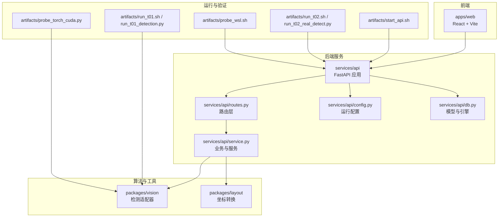
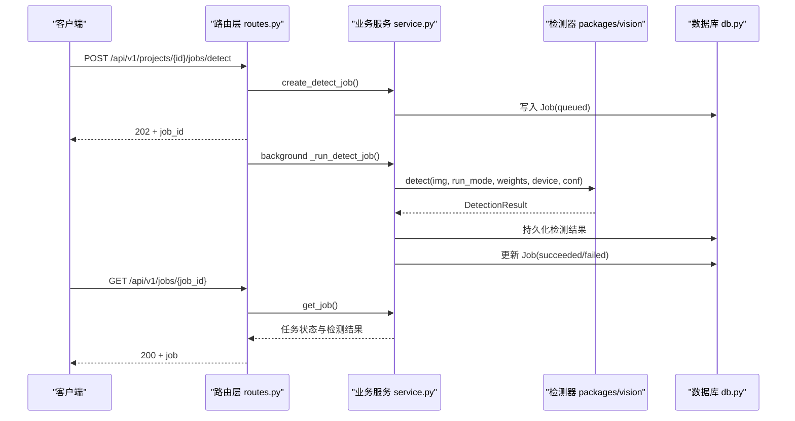
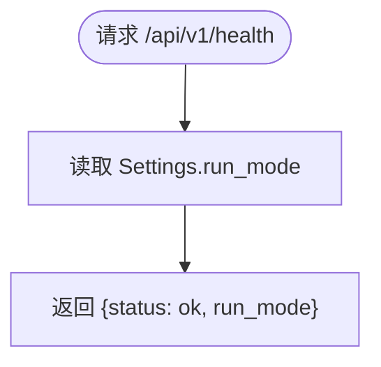
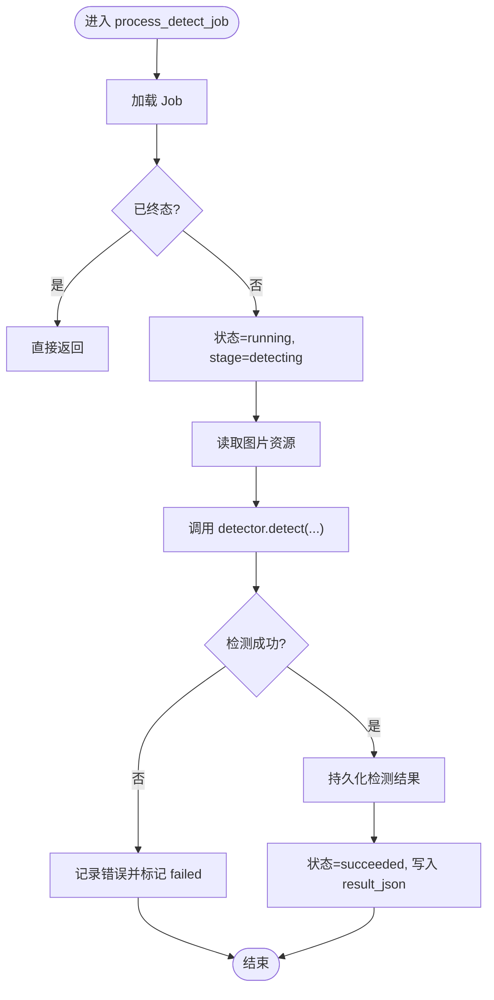
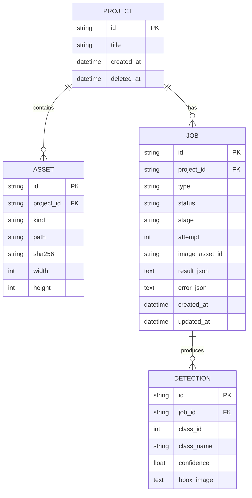
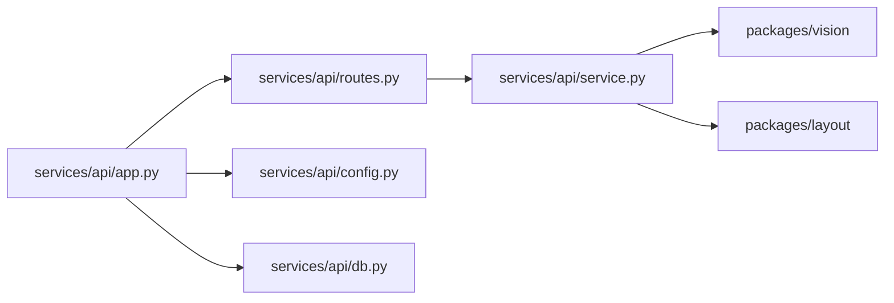
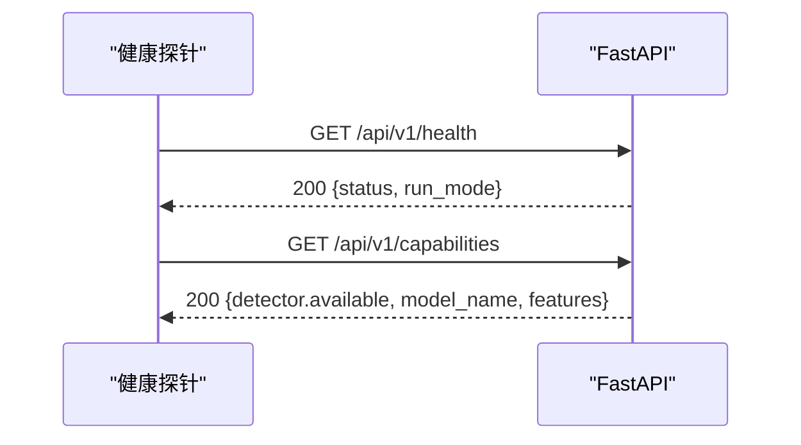

# 部署运维

<cite>
**本文引用的文件**   
- [README.md](file://README.md)
- [ENVIRONMENT.md](file://docs/ENVIRONMENT.md)
- [pyproject.toml](file://pyproject.toml)
- [start_api.sh](file://artifacts/start_api.sh)
- [run_t01.sh](file://artifacts/run_t01.sh)
- [run_t02.sh](file://artifacts/run_t02.sh)
- [run_t01_detection.py](file://artifacts/run_t01_detection.py)
- [run_t02_real_detect.py](file://artifacts/run_t02_real_detect.py)
- [probe_wsl.sh](file://artifacts/probe_wsl.sh)
- [probe_torch_cuda.py](file://artifacts/probe_torch_cuda.py)
- [app.py](file://services/api/app.py)
- [routes.py](file://services/api/routes.py)
- [config.py](file://services/api/config.py)
- [db.py](file://services/api/db.py)
- [service.py](file://services/api/service.py)
</cite>

## 目录
1. [简介](#简介)
2. [项目结构](#项目结构)
3. [核心组件](#核心组件)
4. [架构总览](#架构总览)
5. [详细组件分析](#详细组件分析)
6. [依赖关系分析](#依赖关系分析)
7. [性能与容量规划](#性能与容量规划)
8. [监控与健康检查](#监控与健康检查)
9. [日志管理与故障排查](#日志管理与故障排查)
10. [备份与恢复策略](#备份与恢复策略)
11. [容器化部署方案](#容器化部署方案)
12. [自动化与生产最佳实践](#自动化与生产最佳实践)
13. [常见问题诊断](#常见问题诊断)
14. [结论](#结论)

## 简介
本指南面向 AstraDesk 的生产部署与运维，覆盖硬件与环境要求、服务启动脚本、健康检查、监控指标、日志与排错、备份恢复、容器化构建与优化，以及自动化与安全加固等实践。文档以仓库现有实现为依据，重点围绕后端 FastAPI 服务、检测任务流程、SQLite 持久化、YOLOv10 真实推理模式，以及 T01/T02 验证脚本展开。

## 项目结构
AstraDesk 采用前后端分离：前端位于 apps/web，后端 API 位于 services/api，算法与适配逻辑在 packages/vision、packages/layout、packages/generation；运行证据与脚本集中在 artifacts；配置与契约定义在 contracts 与 docs。

图示来源
- [app.py:1-48](file://services/api/app.py#L1-L48)
- [routes.py:1-143](file://services/api/routes.py#L1-L143)
- [service.py:1-237](file://services/api/service.py#L1-L237)
- [config.py:1-61](file://services/api/config.py#L1-L61)
- [db.py:1-92](file://services/api/db.py#L1-L92)
- [start_api.sh:1-20](file://artifacts/start_api.sh#L1-L20)
- [run_t01.sh:1-7](file://artifacts/run_t01.sh#L1-L7)
- [run_t02.sh:1-8](file://artifacts/run_t02.sh#L1-L8)
- [probe_wsl.sh:1-19](file://artifacts/probe_wsl.sh#L1-L19)
- [probe_torch_cuda.py:1-24](file://artifacts/probe_torch_cuda.py#L1-L24)

章节来源
- [README.md:8-24](file://README.md#L8-L24)

## 核心组件
- FastAPI 应用装配：创建应用、注册中间件、挂载路由、注入数据库连接与设置对象。
- 路由层：统一前缀 /api/v1，提供健康检查、能力探测、项目管理、图像上传、异步检测任务与结果查询。
- 业务服务：项目/资产/任务生命周期管理、图像预处理与存储、检测任务执行、检测结果持久化。
- 配置系统：从环境变量加载运行模式、数据库 URL、数据根路径、权重路径、设备与置信度阈值。
- 数据模型：基于 SQLAlchemy 的 SQLite 模型（Project、Asset、Job、Detection），并提供引擎与会话工厂。
- 运行脚本：start_api.sh 启动 API 并自检；run_t01.sh 执行独立检测验证；run_t02.sh 走完整 API 栈端到端验证。

章节来源
- [app.py:1-48](file://services/api/app.py#L1-L48)
- [routes.py:1-143](file://services/api/routes.py#L1-L143)
- [service.py:1-237](file://services/api/service.py#L1-L237)
- [config.py:1-61](file://services/api/config.py#L1-L61)
- [db.py:1-92](file://services/api/db.py#L1-L92)
- [start_api.sh:1-20](file://artifacts/start_api.sh#L1-L20)
- [run_t01.sh:1-7](file://artifacts/run_t01.sh#L1-L7)
- [run_t02.sh:1-8](file://artifacts/run_t02.sh#L1-L8)

## 架构总览
AstraDesk 后端采用“路由层薄、业务层厚”的分层设计：路由仅处理协议与参数，业务规则集中在 service；检测任务通过 FastAPI BackgroundTasks 异步执行，worker 进程可独立轮询队列。

图示来源
- [routes.py:118-143](file://services/api/routes.py#L118-L143)
- [service.py:120-179](file://services/api/service.py#L120-L179)
- [db.py:26-77](file://services/api/db.py#L26-L77)

## 详细组件分析

### 服务启动与健康检查
- 健康检查端点返回运行模式，便于探针判断服务是否就绪及当前推理模式。
- 能力探测端点会尝试加载权重或返回 mock 能力，用于编排与降级决策。

图示来源
- [routes.py:44-48](file://services/api/routes.py#L44-L48)
- [config.py:20-31](file://services/api/config.py#L20-L31)

章节来源
- [routes.py:44-65](file://services/api/routes.py#L44-L65)
- [config.py:39-61](file://services/api/config.py#L39-L61)

### 检测任务执行流程
- 异步任务：POST 创建任务后立即返回 202，后台执行检测。
- 失败处理：区分 MODEL_UNAVAILABLE、业务错误与内部异常，标记 retryable 标志。
- 结果持久化：将检测结果写入 Detection 表，并序列化摘要到 Job.result_json。

图示来源
- [service.py:132-179](file://services/api/service.py#L132-L179)
- [service.py:182-198](file://services/api/service.py#L182-L198)

章节来源
- [service.py:120-237](file://services/api/service.py#L120-L237)

### 配置与环境变量
- 运行模式：ASTRADESK_RUN_MODE，支持 real 与 mock；demo 等价于 mock。
- 数据库：ASTRADESK_DB_URL，默认 SQLite 文件路径由 data_root 推导。
- 数据根：ASTRADESK_DATA_ROOT，控制上传与缩略图存储位置。
- 权重路径：ASTRADESK_YOLO_WEIGHTS，指向 YOLOv10 权重文件。
- 设备与阈值：ASTRADESK_DEVICE、ASTRADESK_DET_CONF。

章节来源
- [config.py:1-61](file://services/api/config.py#L1-L61)

### 数据模型与持久化
- Project：项目元信息，含创建时间与软删除字段。
- Asset：图像资产，包含 canonical 与 thumbnail 两类，记录尺寸与哈希。
- Job：任务生命周期，含类型、状态、阶段、尝试次数、结果与错误 JSON。
- Detection：单次检测框，包含类别、置信度与归一化边界框。

图示来源
- [db.py:26-77](file://services/api/db.py#L26-L77)

章节来源
- [db.py:1-92](file://services/api/db.py#L1-L92)

### 启动脚本与验证任务
- start_api.sh：设置 real 模式、权重路径与数据根，后台启动 uvicorn，等待健康检查与能力探测。
- run_t01.sh：调用 run_t01_detection.py，使用本地 YOLOv10n 权重对数据集样本进行 GPU 推理，输出标注图与 result.json。
- run_t02.sh：调用 run_t02_real_detect.py，通过 TestClient 走完整 API 栈，完成项目创建、图像上传、检测任务与结果查询，生成 annotated.jpg 与 result.json。

章节来源
- [start_api.sh:1-20](file://artifacts/start_api.sh#L1-L20)
- [run_t01.sh:1-7](file://artifacts/run_t01.sh#L1-L7)
- [run_t01_detection.py:1-79](file://artifacts/run_t01_detection.py#L1-L79)
- [run_t02.sh:1-8](file://artifacts/run_t02.sh#L1-L8)
- [run_t02_real_detect.py:1-108](file://artifacts/run_t02_real_detect.py#L1-L108)

## 依赖关系分析
后端核心依赖包括 FastAPI、Uvicorn、SQLAlchemy、Pydantic、Pillow 与 python-multipart；可选依赖 vision 包含 torch 与 ultralytics。

图示来源
- [app.py:1-48](file://services/api/app.py#L1-L48)
- [routes.py:1-143](file://services/api/routes.py#L1-L143)
- [service.py:1-237](file://services/api/service.py#L1-L237)
- [config.py:1-61](file://services/api/config.py#L1-L61)
- [db.py:1-92](file://services/api/db.py#L1-L92)

章节来源
- [pyproject.toml:1-37](file://pyproject.toml#L1-L37)

## 性能与容量规划
- GPU 推荐：NVIDIA RTX 4050 Laptop（约 6GB 显存）已在 WSL2 下实测可用；CUDA 运行时随 PyTorch cu124 轮子提供，无需额外安装 nvcc。
- CPU 推理：在无 GPU 环境可使用 CPU，但延迟显著增加；建议优先启用 CUDA。
- 内存与显存：首次推理包含模型加载，后续推理显存占用较低；可通过 ASTRADESK_DET_CONF 调整阈值以减少检测数量。
- I/O：建议使用 WSL 原生 ext4 文件系统存放 data 与 weights，避免跨宿主盘慢 I/O。

章节来源
- [ENVIRONMENT.md:5-24](file://docs/ENVIRONMENT.md#L5-L24)
- [README.md:26-31](file://README.md#L26-L31)

## 监控与健康检查
- 健康检查：GET /api/v1/health 返回状态与运行模式，适合 Kubernetes liveness/readiness 探针。
- 能力探测：GET /api/v1/capabilities 返回 detector 可用性、模型名称与版本，可用于自动降级或告警。
- 任务状态：GET /api/v1/jobs/{job_id} 返回任务状态、阶段、结果摘要与错误信息，便于外部调度与重试。

图示来源
- [routes.py:44-65](file://services/api/routes.py#L44-L65)

章节来源
- [routes.py:44-65](file://services/api/routes.py#L44-L65)

## 日志管理与故障排查
- 启动日志：start_api.sh 将 uvicorn 输出重定向至 /tmp/astradesk_api.log，便于查看启动信息与错误堆栈。
- 任务错误：service.py 将错误信息序列化到 Job.error_json，包含 code、message 与 retryable 标志。
- 常见错误：
  - MODEL_UNAVAILABLE：real 模式下权重缺失或依赖不可用，需检查 ASTRADESK_YOLO_WEIGHTS 与 GPU/CUDA 环境。
  - INVALID_IMAGE：不支持的文件类型或空文件，需校验前端上传类型与大小。
  - ASSET_NOT_FOUND：资产不存在或属于其他项目，需核对 project_id 与 image_asset_id。
  - JOB_NOT_FOUND：任务不存在或已被清理，需确认 job_id 有效性。

章节来源
- [start_api.sh:7-19](file://artifacts/start_api.sh#L7-L19)
- [service.py:132-186](file://services/api/service.py#L132-L186)
- [service.py:202-228](file://services/api/service.py#L202-L228)

## 备份与恢复策略
- 数据库备份：SQLite 文件位于 ASTRADESK_DB_URL 指定路径，可直接 cp 或使用 sqlite3 热备（建议停止写入后备份）。
- 文件存储管理：ASTRADESK_DATA_ROOT 下的 canonical 与 thumbnail 文件需纳入备份；建议定期归档并按项目 ID 组织。
- 配置版本控制：ASTRADESK_* 环境变量应通过配置中心或密钥管理保存，不入库；建议对 .env 模板与部署清单做版本控制。
- 权重与模型：weights/yolov10n.pt 需单独备份与校验 SHA256，确保一致性。

章节来源
- [config.py:39-61](file://services/api/config.py#L39-L61)
- [db.py:84-92](file://services/api/db.py#L84-L92)

## 容器化部署方案
说明：仓库未提供 Dockerfile 与镜像构建脚本；以下为基于现有实现的通用容器化建议，供生产落地参考。

- 基础镜像：选择带 CUDA 12.x 的 Python 镜像（如 nvidia/cuda:12.x-runtime-ubuntu22.04），并在镜像内安装 Python 3.10–3.12。
- 多阶段构建：
  - 构建阶段：安装构建依赖（torch、ultralytics），下载权重文件，缓存 wheel 加速重复构建。
  - 运行阶段：仅复制必要二进制与依赖，减小镜像体积。
- 环境变量注入：
  - ASTRADESK_RUN_MODE=real
  - ASTRADESK_DB_URL=sqlite:///data/astradesk.db
  - ASTRADESK_DATA_ROOT=/data
  - ASTRADESK_YOLO_WEIGHTS=/models/yolov10n.pt
  - ASTRADESK_DEVICE=cuda:0（可选）
  - ASTRADESK_DET_CONF=0.25（可选）
- 卷挂载：
  - /data：持久化数据库与上传文件
  - /models：挂载权重文件
  - /logs：挂载服务日志
- 健康检查：容器健康检查命令调用 curl 访问 /api/v1/health，结合 /api/v1/capabilities 判定能力。
- 资源限制：为容器设置 CPU 与内存上限，GPU 通过 --gpus all 或特定设备分配。

[本节为概念性指导，不直接分析具体源码文件]

## 自动化与生产最佳实践
- 自动重启：使用 systemd 或容器编排平台（Kubernetes）管理进程生命周期，配合 liveness/readiness 探针。
- 资源限制：限制 CPU、内存与 GPU 显存，防止单实例抢占宿主机资源。
- 安全加固：
  - 仅暴露必要端口（如 8000），并通过反向代理（Nginx/Traefik）与 TLS 终止。
  - 最小权限原则运行服务账户，避免 root 运行。
  - 敏感凭据（远端 VL/生成密钥）仅从服务端环境变量读取，不入仓库、日志或前端。
- 灰度与回滚：按版本发布镜像，保留旧镜像以便快速回滚；通过能力探测与特性开关控制功能上线。

[本节为通用实践建议，不直接分析具体源码文件]

## 常见问题诊断
- 无法加载 GPU：
  - 检查 nvidia-smi 与 torch.cuda.is_available()；使用 artifacts/probe_wsl.sh 与 artifacts/probe_torch_cuda.py 收集环境信息。
  - 确认驱动与 CUDA 运行时版本匹配；WSL2 环境下 PyTorch cu124 轮子自带运行时。
- 权重缺失或路径错误：
  - 检查 ASTRADESK_YOLO_WEIGHTS 指向的文件是否存在且可读；确认容器内路径映射正确。
- 检测任务失败：
  - 查看 Job.error_json 中的 code 与 message；MODEL_UNAVAILABLE 表示依赖或权重问题；INTERNAL 表示内部异常，需查看服务日志。
- 前端无法访问 API：
  - 确认 CORS 配置允许前端域名；开发环境默认允许 localhost:5173 与 127.0.0.1:5173。
- 磁盘空间不足：
  - 检查 data 与 weights 目录占用；清理历史缩略图与临时文件；扩展卷容量。

章节来源
- [probe_wsl.sh:1-19](file://artifacts/probe_wsl.sh#L1-L19)
- [probe_torch_cuda.py:1-24](file://artifacts/probe_torch_cuda.py#L1-L24)
- [app.py:36-43](file://services/api/app.py#L36-L43)
- [service.py:132-186](file://services/api/service.py#L132-L186)

## 结论
AstraDesk 的后端以 FastAPI 为核心，结合 SQLite 与 YOLOv10 真实推理，提供了从项目创建、图像上传到异步检测任务的完整链路。生产部署需重点关注 GPU 与 CUDA 环境、环境变量注入、健康检查与能力探测、日志与错误追踪、数据与权重备份，以及容器化与自动化运维。通过本文档的操作指南与最佳实践，可在保证稳定性的前提下高效交付桌面智能整理能力。