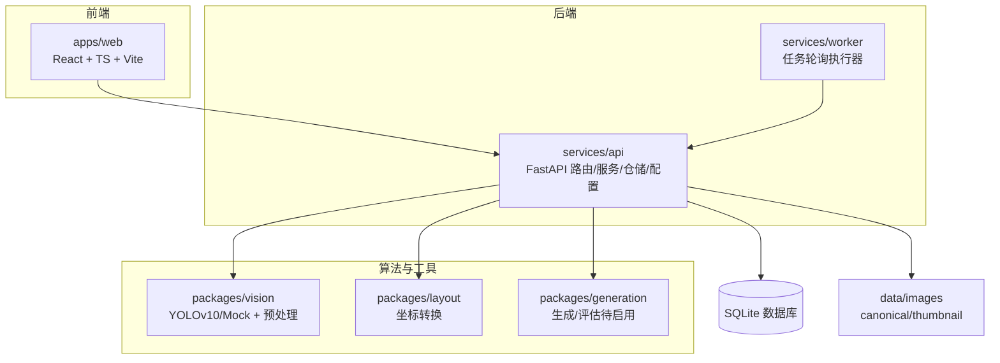
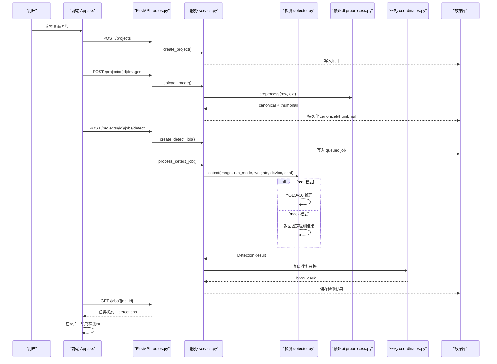
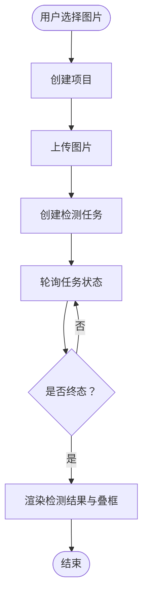
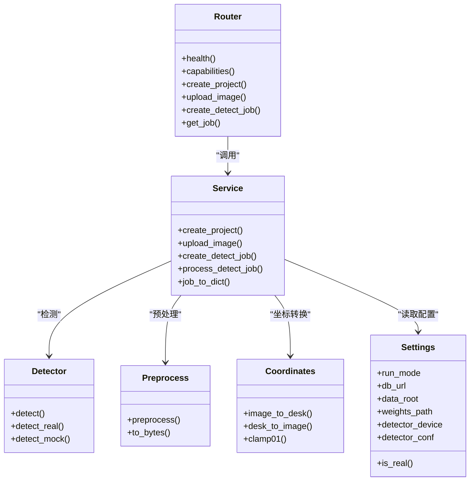
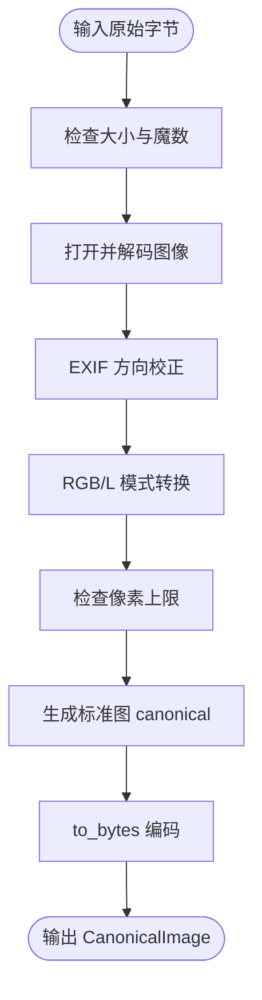
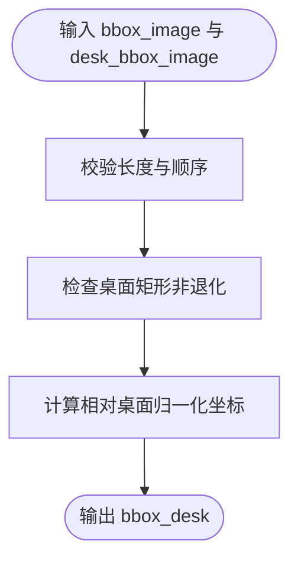
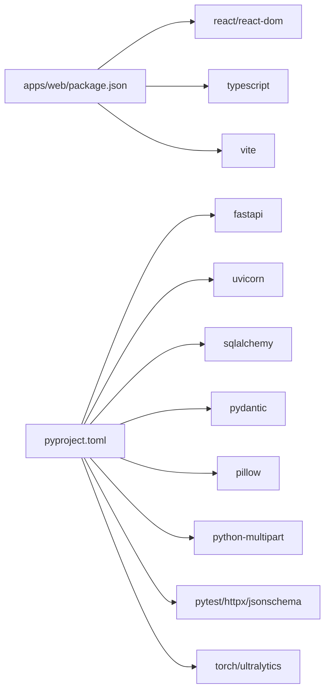

# 项目概述

<cite>
**本文引用的文件**   
- [README.md](file://README.md)
- [ENVIRONMENT.md](file://docs/ENVIRONMENT.md)
- [pyproject.toml](file://pyproject.toml)
- [package.json](file://apps/web/package.json)
- [app.py](file://services/api/app.py)
- [routes.py](file://services/api/routes.py)
- [service.py](file://services/api/service.py)
- [config.py](file://services/api/config.py)
- [runner.py](file://services/worker/runner.py)
- [detector.py](file://packages/vision/detector.py)
- [preprocess.py](file://packages/vision/preprocess.py)
- [coordinates.py](file://packages/layout/coordinates.py)
- [App.tsx](file://apps/web/src/App.tsx)
- [api.ts](file://apps/web/src/api.ts)
</cite>

## 目录
1. [引言](#引言)
2. [项目结构](#项目结构)
3. [核心组件](#核心组件)
4. [架构总览](#架构总览)
5. [详细组件分析](#详细组件分析)
6. [依赖关系分析](#依赖关系分析)
7. [性能与运行模式](#性能与运行模式)
8. [故障排查指南](#故障排查指南)
9. [结论](#结论)
10. [附录：端到端使用示例](#附录端到端使用示例)

## 引言
AstraDesk 桌面智能整理系统的目标是：用户上传一张桌面照片，系统识别桌面上的物品，用户设置整理偏好后，生成可编辑的布局方案、整理步骤与效果图。当前阶段已实现“上传 → 检测 → 可视化”的完整链路，并预留了后续布局规划与图像生成的扩展点。

技术栈采用 Python + TypeScript + FastAPI + React 的全栈分离架构：前端负责交互与可视化，后端提供 REST API、任务编排、存储与契约校验；视觉检测通过 YOLOv10 完成，坐标转换由独立工具包提供。该架构便于前后端并行开发、独立部署与测试，也便于在真实模型与 Mock 之间切换，满足无 GPU 环境下的开发与演示需求。

**章节来源**
- [README.md:1-8](file://README.md#L1-L8)

## 项目结构
仓库按职责分层组织：
- apps/web：React + TypeScript + Vite 前端应用，负责图片选择、上传、检测结果轮询与叠框可视化。
- services/api：FastAPI 服务，包含路由、应用装配、业务服务、数据库、配置、错误处理与静态资源访问。
- services/worker：后台任务执行入口，支持轮询处理排队中的检测任务。
- packages/vision：检测适配器（YOLOv10 与 Mock）与图像预处理模块。
- packages/layout：坐标契约转换工具，负责原图归一化坐标与桌面归一化坐标之间的双向转换。
- packages/generation：未来 B 阶段的生成与评估适配器占位。
- contracts：JSON Schema 与合法/非法样例，作为契约单一来源。
- tests：契约校验、坐标往返一致性、检测端到端等测试。
- artifacts/docs/data/weights：运行证据、文档、数据与权重（不入库）。

**图表来源**
- [app.py:1-48](file://services/api/app.py#L1-L48)
- [routes.py:1-143](file://services/api/routes.py#L1-L143)
- [service.py:1-237](file://services/api/service.py#L1-L237)
- [config.py:1-61](file://services/api/config.py#L1-L61)
- [runner.py:1-43](file://services/worker/runner.py#L1-L43)
- [detector.py:1-129](file://packages/vision/detector.py#L1-L129)
- [preprocess.py:1-84](file://packages/vision/preprocess.py#L1-L84)
- [coordinates.py:1-63](file://packages/layout/coordinates.py#L1-L63)

**章节来源**
- [README.md:8-24](file://README.md#L8-L24)
- [pyproject.toml:1-37](file://pyproject.toml#L1-L37)

## 核心组件
- 前端应用（apps/web）：提供图片选择、创建项目、上传图片、发起检测任务、轮询任务状态并在图片上绘制检测框。
- FastAPI 服务（services/api）：健康检查、能力查询、项目管理、图片上传与存储、异步检测任务、结果查询与资产下载。
- 任务执行器（services/worker）：轮询数据库中 queued 的检测任务并调用服务层执行。
- 视觉检测（packages/vision）：统一 detect 入口，根据运行模式分派到真实 YOLOv10 或 Mock；提供图像预处理与标准图输出。
- 坐标转换（packages/layout）：定义 bbox_image 与 bbox_desk 的坐标约定，并提供 image_to_desk / desk_to_image 等转换函数。
- 配置与环境（services/api/config.py）：从环境变量加载运行模式、数据库 URL、数据根路径、权重路径、设备与置信度阈值。

**章节来源**
- [App.tsx:1-134](file://apps/web/src/App.tsx#L1-L134)
- [api.ts:1-119](file://apps/web/src/api.ts#L1-L119)
- [routes.py:1-143](file://services/api/routes.py#L1-L143)
- [service.py:1-237](file://services/api/service.py#L1-L237)
- [runner.py:1-43](file://services/worker/runner.py#L1-L43)
- [detector.py:1-129](file://packages/vision/detector.py#L1-L129)
- [preprocess.py:1-84](file://packages/vision/preprocess.py#L1-L84)
- [coordinates.py:1-63](file://packages/layout/coordinates.py#L1-L63)
- [config.py:1-61](file://services/api/config.py#L1-L61)

## 架构总览
系统采用前后端分离、服务与算法解耦的设计：
- 前端通过 /api/v1 访问后端，不持有模型密钥。
- 后端路由仅做协议处理，业务逻辑集中在 service 层。
- 检测任务以异步方式执行，支持请求内 BackgroundTasks 与独立 worker 两种运行方式。
- 视觉检测通过 packages/vision 抽象，支持 real/mock 双模式。
- 坐标转换通过 packages/layout 提供，保证 bbox_image 与 bbox_desk 的双向一致性与边界校验。

**图表来源**
- [App.tsx:28-50](file://apps/web/src/App.tsx#L28-L50)
- [api.ts:68-118](file://apps/web/src/api.ts#L68-L118)
- [routes.py:70-143](file://services/api/routes.py#L70-L143)
- [service.py:73-179](file://services/api/service.py#L73-L179)
- [detector.py:50-129](file://packages/vision/detector.py#L50-L129)
- [preprocess.py:54-84](file://packages/vision/preprocess.py#L54-L84)
- [coordinates.py:44-55](file://packages/layout/coordinates.py#L44-L55)

## 详细组件分析

### 前端应用（apps/web）
- 功能要点：
  - 启动时获取后端能力信息，显示运行模式与检测器可用性。
  - 用户选择图片后，依次创建项目、上传图片、发起检测任务并轮询结果。
  - 将检测结果 bbox_image（归一化坐标）映射为百分比样式，叠加在原图上。
  - 展示检测结果列表与元信息（模型名、运行模式、耗时、数量）。
- 关键流程：
  - 文件选择 → 创建项目 → 上传图片 → 创建检测任务 → 轮询任务 → 渲染叠框。
- 错误处理：
  - 捕获网络与业务错误，显示错误消息；任务失败时读取 error.code 与 message。

**图表来源**
- [App.tsx:28-50](file://apps/web/src/App.tsx#L28-L50)
- [api.ts:68-118](file://apps/web/src/api.ts#L68-L118)

**章节来源**
- [App.tsx:1-134](file://apps/web/src/App.tsx#L1-L134)
- [api.ts:1-119](file://apps/web/src/api.ts#L1-L119)

### FastAPI 服务（services/api）
- 应用装配（app.py）：
  - 初始化 Settings、数据库引擎与会话工厂。
  - 注册错误处理器、CORS 中间件与路由。
- 路由（routes.py）：
  - 健康检查与健康能力接口。
  - 项目 CRUD、图片上传、资产下载。
  - 检测任务创建与查询；后台任务调用 service.process_detect_job。
- 服务层（service.py）：
  - 项目与资产的业务规则与持久化。
  - 图片预处理、标准图与缩略图生成。
  - 检测任务生命周期管理（queued → running → succeeded/failed）。
  - 检测结果持久化与查询装配。
- 配置（config.py）：
  - 从环境变量加载运行模式、数据库 URL、数据根路径、权重路径、设备与置信度阈值。
  - 默认 mock，避免未配置时误触发真实模型或收费后端。

**图表来源**
- [app.py:1-48](file://services/api/app.py#L1-L48)
- [routes.py:1-143](file://services/api/routes.py#L1-L143)
- [service.py:1-237](file://services/api/service.py#L1-L237)
- [config.py:1-61](file://services/api/config.py#L1-L61)
- [detector.py:1-129](file://packages/vision/detector.py#L1-L129)
- [preprocess.py:1-84](file://packages/vision/preprocess.py#L1-L84)
- [coordinates.py:1-63](file://packages/layout/coordinates.py#L1-L63)

**章节来源**
- [app.py:1-48](file://services/api/app.py#L1-L48)
- [routes.py:1-143](file://services/api/routes.py#L1-L143)
- [service.py:1-237](file://services/api/service.py#L1-L237)
- [config.py:1-61](file://services/api/config.py#L1-L61)

### 视觉检测与预处理（packages/vision）
- 检测适配器（detector.py）：
  - 统一 detect 入口，按 run_mode 分派到 detect_real 或 detect_mock。
  - real 模式使用 ultralytics YOLOv10，懒加载并缓存模型；缺依赖或权重抛出 DetectorUnavailable。
  - mock 模式返回确定性检测结果，model_name 显式标注 mock。
- 预处理（preprocess.py）：
  - 校验文件大小、魔数、损坏图、像素上限。
  - EXIF 方向校正，去除元数据，输出标准图 canonical。
  - to_bytes 编码为标准 JPEG/PNG。

**图表来源**
- [preprocess.py:43-84](file://packages/vision/preprocess.py#L43-L84)

**章节来源**
- [detector.py:1-129](file://packages/vision/detector.py#L1-L129)
- [preprocess.py:1-84](file://packages/vision/preprocess.py#L1-L84)

### 坐标转换工具包（packages/layout）
- 坐标约定：
  - bbox_image：相对整张原图归一化 0-1，左上原点，x 向右、y 向下。
  - desk_bbox_image：桌面矩形，使用同一原图坐标。
  - bbox_desk：相对桌面矩形归一化；x_desk = (x_image - dx1) / (dx2 - dx1)，y 同理。
- 转换函数：
  - image_to_desk：原图归一化框 → 桌面归一化框。
  - desk_to_image：桌面归一化框 → 原图归一化框。
  - clamp01：裁剪归一化框到 [0,1]，用于展示与越界检查辅助。
- 校验：
  - 长度、顺序、退化桌面矩形等非法情况抛出 CoordinateError。

**图表来源**
- [coordinates.py:26-55](file://packages/layout/coordinates.py#L26-L55)

**章节来源**
- [coordinates.py:1-63](file://packages/layout/coordinates.py#L1-L63)

### 任务执行器（services/worker）
- runner.py 提供最小化的轮询执行器：
  - 周期性查询数据库中 type=detect 且 status=queued 的任务。
  - 调用 service.process_detect_job 执行检测。
  - 打印处理日志，支持 KeyboardInterrupt 停止。
- 说明：T02 的 API 已通过 BackgroundTasks 在请求进程内执行检测；本 worker 提供解耦运行入口，健壮性（租约/心跳/过期恢复）属于 T06–T07 范围，此处尚未实现。

**章节来源**
- [runner.py:1-43](file://services/worker/runner.py#L1-L43)

## 依赖关系分析
- 前端依赖 React、TypeScript、Vite，构建产物位于 dist/。
- 后端依赖 FastAPI、uvicorn、SQLAlchemy、Pydantic、Pillow、python-multipart。
- 可选依赖 vision：torch、ultralytics（YOLOv10）。
- 测试依赖 pytest、httpx、jsonschema。

**图表来源**
- [package.json:1-23](file://apps/web/package.json#L1-L23)
- [pyproject.toml:1-37](file://pyproject.toml#L1-L37)

**章节来源**
- [package.json:1-23](file://apps/web/package.json#L1-L23)
- [pyproject.toml:1-37](file://pyproject.toml#L1-L37)

## 性能与运行模式
- 运行模式：
  - real：真实模型推理；检测缺权重/依赖直接报 MODEL_UNAVAILABLE，不静默回退 mock。
  - mock：确定性 Mock，仅用于无 GPU 的契约测试与 demo，能力接口如实标注 mock-detector。
- 环境变量：
  - ASTRADESK_RUN_MODE：real 或 mock。
  - ASTRADESK_DB_URL：数据库连接字符串（默认 SQLite）。
  - ASTRADESK_DATA_ROOT：数据根路径（默认 data/）。
  - ASTRADESK_YOLO_WEIGHTS：YOLOv10 权重路径（默认 weights/yolov10n.pt）。
  - ASTRADESK_DEVICE：设备标识（空则自动选择）。
  - ASTRADESK_DET_CONF：检测置信度阈值（默认 0.25）。
- 性能特性：
  - 模型懒加载与进程内缓存，避免重复加载。
  - 图片预处理限制文件大小与像素上限，防止过大输入拖慢服务。
  - 检测结果持久化，前端轮询任务状态，避免长连接压力。

**章节来源**
- [README.md:71-77](file://README.md#L71-L77)
- [config.py:1-61](file://services/api/config.py#L1-L61)
- [detector.py:50-129](file://packages/vision/detector.py#L50-L129)
- [preprocess.py:14-16](file://packages/vision/preprocess.py#L14-L16)

## 故障排查指南
- 常见错误与定位：
  - MODEL_UNAVAILABLE：real 模式下缺少 ultralytics 或权重文件；检查 ASTRADESK_RUN_MODE、ASTRADESK_YOLO_WEIGHTS 与依赖安装。
  - INVALID_IMAGE：文件类型不支持、魔数不匹配、损坏或超过 10MB/25MP；检查上传文件与预处理逻辑。
  - ASSET_NOT_FOUND：资产不存在或不属于项目；检查项目与资产关联。
  - JOB_NOT_FOUND：任务不存在；检查任务 ID 与状态。
  - SCHEMA_INVALID：坐标长度错误或桌面矩形退化；检查坐标转换输入。
- 调试建议：
  - 使用 /api/v1/health 与 /api/v1/capabilities 确认服务状态与能力。
  - 查看任务 error_json 与 result_json，定位失败原因与检测结果摘要。
  - 在前端控制台观察 pollJob 轮询过程与错误消息。

**章节来源**
- [service.py:132-186](file://services/api/service.py#L132-L186)
- [routes.py:108-115](file://services/api/routes.py#L108-L115)
- [coordinates.py:17-41](file://packages/layout/coordinates.py#L17-L41)
- [preprocess.py:24-31](file://packages/vision/preprocess.py#L24-L31)

## 结论
AstraDesk 当前实现了从图片上传到检测结果可视化的完整链路，并通过 real/mock 运行模式兼顾真实推理与无 GPU 环境下的开发与演示。前后端分离、服务与算法解耦的设计使系统具备良好的可扩展性：后续可在现有检测与坐标体系基础上接入多模态理解与图像生成，形成完整的 A/B 阶段 MVP。

## 附录：端到端使用示例
以下示例展示从图片上传到检测结果可视化的完整流程，术语与代码库保持一致：

- 前置条件：
  - 后端运行于 WSL，端口 8000；前端运行于 Windows，端口 5173。
  - 若使用真实检测，设置 ASTRADESK_RUN_MODE=real 与 ASTRADESK_YOLO_WEIGHTS=weights/yolov10n.pt。
- 操作步骤：
  - 打开前端 http://localhost:5173，页面加载能力信息。
  - 选择一张桌面照片（JPEG/PNG，≤10MB）。
  - 前端依次调用：
    - POST /api/v1/projects：创建项目。
    - POST /api/v1/projects/{id}/images：上传图片，返回 image_asset_id。
    - POST /api/v1/projects/{id}/jobs/detect：创建检测任务。
    - GET /api/v1/jobs/{job_id}：轮询任务状态直至终态。
  - 前端根据检测结果 bbox_image 在图片上绘制彩色叠框，并显示类别名称与置信度。
- 预期结果：
  - 成功：任务状态为 succeeded，result.count 为非负整数，detections 列表包含若干检测项。
  - 失败：任务状态为 failed，error.code 为 MODEL_UNAVAILABLE/INVALID_IMAGE/ASSET_NOT_FOUND/JOB_NOT_FOUND 等，error.message 提供具体原因。

**章节来源**
- [README.md:33-69](file://README.md#L33-L69)
- [App.tsx:28-50](file://apps/web/src/App.tsx#L28-L50)
- [api.ts:68-118](file://apps/web/src/api.ts#L68-L118)
- [routes.py:70-143](file://services/api/routes.py#L70-L143)
- [service.py:73-179](file://services/api/service.py#L73-L179)